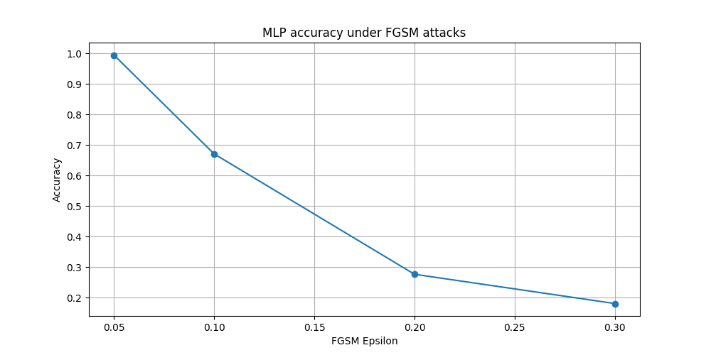

# AI Network Defender

## Overview
I wanted to test how easily a machine learning model trained to catch network attacks can be fooled by minor, hidden changes 
made to input network data and whether retraining it on the fabricated data makes it stronger.

To test this, I built a project that trains a PyTorch neural network on the CICIDS2017 dataset to detect malicious or 
fabricated network traffic. Then I ran Fast Gradient Sign Method (FGSM) adversarial attacks across different attack strengths 
(epsilon) and finally I analyzed how well adversarial training protects it against such attacks.

## Pipeline and Project Structure
- **1. Preparing the Data (src/data_loader.py):** Loads the CICIDS2017 network traffic CSV file, cleans any missing values, 
labels benign (safe traffic) as `0` and attacks as `1`. Then it splits the data where 80% is used to train the ML model and 20% is used to test it.
- **2. Baseline Training (src/model_trainer.py):** Trains a PyTorch neural network classifier on standard network traffic to see 
how accurately it can detect attacks before the network traffic is modified or tampered with.
- **3. FGSM attack and Adversarial Training (src/adversarial_attack.py):** Uses IBM's Adversarial Robustness Toolbox (ART) to
slightly tweak test inputs in the direction of the loss gradient across epsilon values of `0.05` to `0.3`, evaluates how
the accuracy drops using different metrics such as accuracy score, a confusion matrix and a classification report which includes precision, recall and F1-score, and then retrains the model on a combination of clean and attacked data.
- **4. Execution and Packet Inspection (main.py, predict.py):** Runs all the steps together, from training to testing, saves the updated model and checks the sample network packets to flag them as malicious or safe.

## Dataset
- **Source:** [CICIDS2017 Dataset](https://www.unb.ca/cic/datasets/ids-2017.html) (also available on [Kaggle](https://www.kaggle.com/datasets/chethuhn/network-intrusion-dataset))
- **File Used:** `Friday-WorkingHours-Afternoon-PortScan.pcap_ISCX.csv`
- **Dataset Size:** 286,096 total network flows across 78 features (228,876 used for training and 57,220 used for testing)

## Key Results
- **Baseline Accuracy (on unmodified data):** 99.97% (99.98% on the 5,000-sample subset)
- **Accuracy under FGSM attack (`epsilon = 0.1`):** 45.32%
- **Accuracy after Adversarial retraining (`epsilon = 0.1`):** 99.54%

### FGSM Epsilon Sweep (Hardened Model) 
- `epsilon = 0.05`: **99.42%**
- `epsilon = 0.10`: **67.06%**
- `epsilon = 0.20`: **27.66%**
- `epsilon = 0.30`: **18.08%**

### Why checking the Confusion Matrix mattered here
Before adversarial retraining, the confusion matrix under the `epsilon = 0.1` FGSM attack (`[[1848, 288], [2446, 418]]`) showed that the model missed **2,446 out of 2,864 actual attacks** (a recall of just **0.15** for malicious traffic). Looking beyond the accuracy score showed how dangerous false negatives are in cybersecurity, even when a classifier looks 99.97% accurate on standard traffic data.



## How to Run
1. Clone the repository and open the `AI-Network-Defender` folder:
   ```bash
   git clone https://github.com/Ridansh10/AI-Network-Defender
   cd AI-Network-Defender
   ```

2. Install the required Python packages from `requirements.txt`:
   ```bash
   pip install -r requirements.txt
   ```

3. Download the CICIDS2017 CSV file, create a `data/` folder, and save the dataset CSV file as `data/network_traffic.csv`.

4. Run `main.py`. This generates two files:
   - `results/fgsm_epsilon_sweep.png` - The line chart that shows how the classifier's accuracy score drops as FGSM epsilon increases from `0.05` to `0.3` (created when `run_epsilon_sweep` runs in `src/adversarial_attack.py`).
   - `models/hardened_defender.pt` - The saved PyTorch model weights (`state_dict`) after adversarial retraining (created at the bottom of `main.py`, which `predict.py` then loads to scan incoming packets).
   ```bash
   python main.py
   ```

5. Run `predict.py` to load the saved model and check whether the sample network traffic rows are flagged as safe or malicious:
   ```bash
   python predict.py
   ```

## Future Improvements & Note
- Currently, the adversarial training only uses examples generated at an epsilon value of 0.1. Training on a mix of epsilon 
values from 0.05 to 0.3 and using the full dataset instead of using only a 5000 row sample could help the model keep its
accuracy higher and withstand stronger attacks.
- The model can be evaluated beyond single-step FGSM attacks by testing stronger iterative attacks like Projected Gradient 
Descent (PGD) to see how well the model performs under these attacks.
- **Development Note:** I designed the whole experiment, selected the CICIDS2017 dataset and the metrics used for evaluating the 
models, ran epsilon sweeps and analyzed the results. I used AI coding tools to assist in writing the boilerplate PyTorch and IBM ART code, which I then debugged and tested myself.